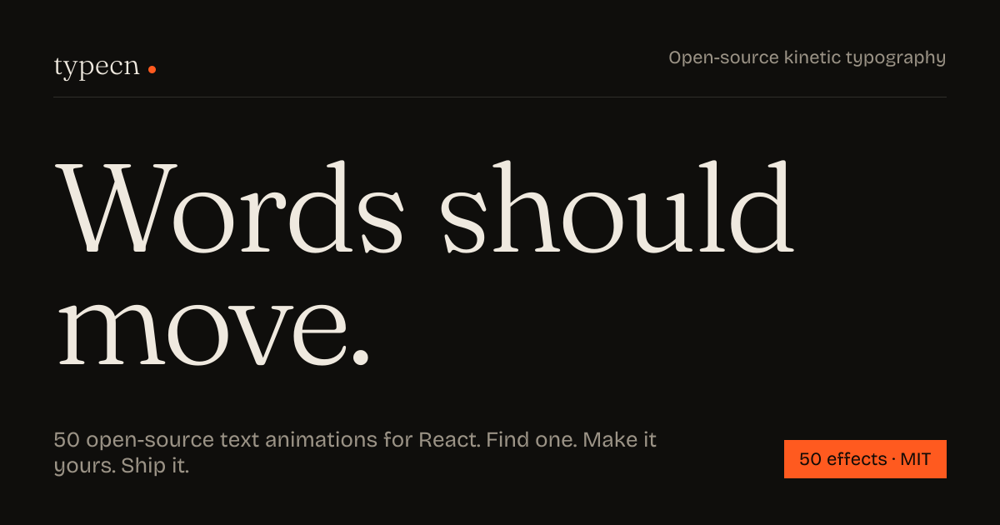
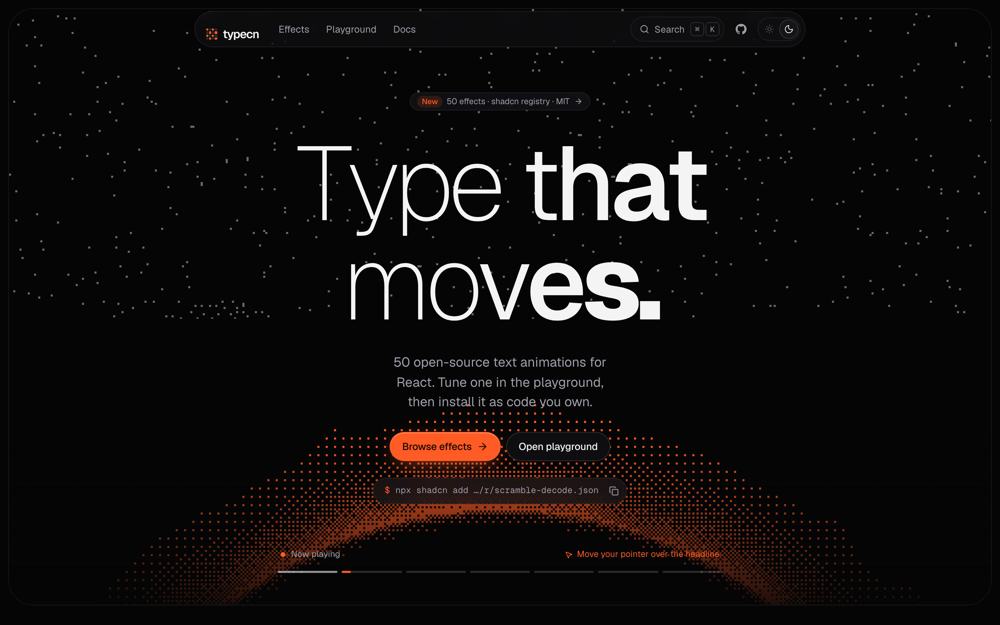
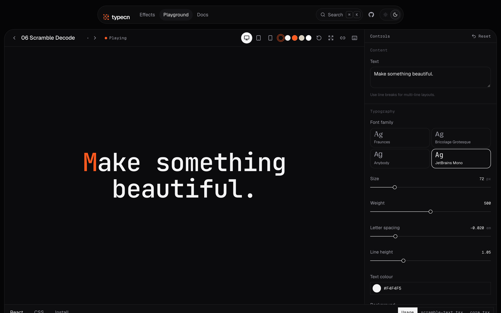
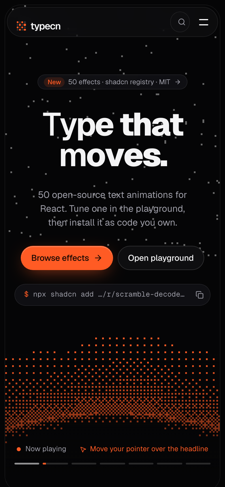

<p align="center">
  
</p>

# typecn

**Typography that moves.** 50 open-source text animations for React — find one, make it yours, ship it.

Scramble effects, variable-font morphs, magnetic letters, scroll reveals, liquid text, WebGL texture masks and more. Every effect is a real, typed React component with live controls, generated code and accessibility built in.

- **50 distinct effects** in five families — no two share a trick.
- **Playground** for every effect: edit text, font, size, weight, tracking, colours, timing, easing and effect-specific settings; copy React or CSS; share a URL that reconstructs the exact preview.
- **Three ways to use it** — shadcn registry (copy the source), a tree-shakeable package, or paste two files.
- **Accessible** — one readable text node for assistive tech, split glyphs are `aria-hidden`, every effect honours `prefers-reduced-motion`.
- **Frugal** — compositor-friendly transforms, no per-frame React renders, loops pause off-screen and in background tabs, everything cleans up.
- **SSR-safe** — works with the Next.js App Router; browser APIs are only touched in effects.

## Screenshots

Screenshots are reproducible: `npm run build && npm run screenshots` writes them to `screenshots/`.

| Home | Playground | Mobile |
|---|---|---|
|  |  |  |

## Quick start

```tsx
import { ScrambleText } from "typecn";

export function Hero() {
  return (
    <ScrambleText
      as="h1"
      text="Make something beautiful."
      duration={1200}
      trigger="inView"
    />
  );
}
```

## Installation

> `typecn` is **not yet published to npm**. The package is fully prepared for publishing (ESM + CJS, `.d.ts`, `sideEffects: false`); until then use one of these:

**A. shadcn registry** — copies `core.tsx` + the effect into `components/typecn` (requires the site to be deployed, or run it locally):

```bash
npx shadcn@latest add http://localhost:3000/r/scramble-decode.json
```

**B. Local package build**

```bash
git clone https://github.com/arjunkshah12345-hash/typecn.git
cd typecn && npm install
npm run build:lib
cd packages/typecn && npm pack
# in your app:
npm install /absolute/path/to/typecn/packages/typecn/typecn-0.1.0.tgz
```

**C. Copy two files** — every effect page shows the exact source of `core.tsx` and the effect file under React → Source.

Peer dependencies: `react` and `react-dom` ≥ 18. Nothing else.

## Common props

| Prop | Applies to | Description |
|---|---|---|
| `text` | all | Text to animate. `\n` creates line breaks. |
| `as`, `className`, `style` | all | Root element and styling. Typography lives on the root. |
| `trigger` | timed | `"mount"` · `"inView"` · `"hover"` · `"manual"` (with `play`). |
| `duration`, `delay`, `stagger` | timed | Milliseconds. |
| `easing` | timed | Preset (`expo.out`, `quart.inOut`, `spring`, …) or any CSS easing. |
| `loop`, `loopDelay`, `once`, `replayKey`, `onComplete` | timed | Repetition and control. |
| `speed`, `paused` | continuous | Tempo and freezing. |
| `progress` | scroll | Drive scroll effects manually (0–1). |

## Effect catalogue

**A · Reveals & entrances**

| Nº | Effect | Component | |
|---|---|---|---|
| 01 | Character Cascade | `CharacterCascade` | Letters fall into line, one after another. |
| 02 | Word Stagger | `WordStagger` | Whole words arrive in measured succession. |
| 03 | Mask Wipe | `MaskWipe` | A solid bar covers each line, then pulls away. |
| 04 | Line Lift | `LineLift` | Lines rise out of an invisible baseline. |
| 05 | Blur Resolve | `BlurResolve` | Out-of-focus letters rack into sharpness. |
| 06 | Scramble Decode | `ScrambleText` | Random glyphs resolve into the message. |
| 07 | Typewriter | `Typewriter` | Human-paced typing with a living caret. |
| 08 | Flip Reveal | `FlipReveal` | Characters rotate into place through 3D space. |
| 09 | Elastic Entrance | `ElasticEntrance` | Letters drop in and spring to shape. |
| 10 | Ink Spread | `InkSpread` | Words bleed onto the page like ink on paper. |

**B · Kinetic & continuous**

| Nº | Effect | Component | |
|---|---|---|---|
| 11 | Wave Text | `WaveText` | A travelling sine wave through the line. |
| 12 | Magnetic Letters | `MagneticLetters` | Every letter leans toward your pointer. |
| 13 | Text Marquee | `TextMarquee` | An endless ribbon that answers your scroll. |
| 14 | Orbiting Words | `OrbitingWords` | Words circle on an elliptical path. |
| 15 | Breathing Type | `BreathingType` | Weight and width inhale and exhale. |
| 16 | Jitter | `Jitter` | Hand-inked letters that boil on the page. |
| 17 | Rolling Characters | `RollingCharacters` | Mechanical counter drums, column by column. |
| 18 | Floating Lines | `FloatingLines` | Lines drift on independent currents. |
| 19 | Pendulum Type | `PendulumType` | A chain of swinging letters. |
| 20 | Ripple Type | `RippleType` | Drop pebbles into a pool of letters. |

**C · Distortion & experiment**

| Nº | Effect | Component | |
|---|---|---|---|
| 21 | Liquid Type | `LiquidType` | Letterforms dissolve into a flowing field. |
| 22 | Glitch Shift | `GlitchShift` | A bad signal tears the type apart. |
| 23 | Pixel Dissolve | `PixelDissolve` | Type assembles from a cloud of pixels. |
| 24 | ASCII Transform | `AsciiTransform` | A scan line converts type into ASCII. |
| 25 | Perspective Bend | `PerspectiveBend` | Type printed on a flexible sheet. |
| 26 | Stretch Type | `StretchType` | A width lens slides across the word. |
| 27 | Slice Shift | `SliceShift` | Misregistered bands pull into alignment. |
| 28 | Noise Reveal | `NoiseReveal` | Type materialises out of static. |
| 29 | Chromatic Split | `ChromaticSplit` | Motion tears the colour channels apart. |
| 30 | Elastic Distortion | `ElasticDistortion` | Rubber letters, stretched toward you. |

**D · Scroll & interactive**

| Nº | Effect | Component | |
|---|---|---|---|
| 31 | Scroll Highlight | `ScrollHighlight` | Words light up in reading order. |
| 32 | Scroll Scrub | `ScrollScrub` | Your scroll is the playhead. |
| 33 | Sticky Typography | `StickyTypography` | A pinned editorial sequence in three acts. |
| 34 | Character Tracking | `CharacterTracking` | The pointer is a spacing tool. |
| 35 | Cursor Repel | `CursorRepel` | Letters scatter from your cursor and drift home. |
| 36 | Hover Shuffle | `HoverShuffle` | Touched letters flicker through glyphs. |
| 37 | Text Trail | `TextTrail` | Your path spells the phrase. |
| 38 | Directional Reveal | `DirectionalReveal` | A second layer floods in from your entry edge. |
| 39 | Kinetic Underline | `KineticUnderline` | Pluck the underline like a string. |
| 40 | Proximity Weight | `ProximityWeight` | A weight lens under your pointer. |

**E · Cinematic & editorial**

| Nº | Effect | Component | |
|---|---|---|---|
| 41 | Editorial Split | `EditorialSplit` | Two panels arrive and close into one line. |
| 42 | Variable Morph | `VariableMorph` | A tour through the font's design space. |
| 43 | Text Mask Video | `TextMaskVideo` | A living texture seen through the letters. |
| 44 | 3D Depth Type | `DepthType` | Extruded type under a moving camera. |
| 45 | Vertical Rolling Headline | `VerticalRollingHeadline` | Headlines on the faces of a turning drum. |
| 46 | Character Explosion | `CharacterExplosion` | Detonate the phrase, then rewind it. |
| 47 | SVG Path Typography | `SvgPathText` | Text flowing along a curve. |
| 48 | Stacked Echo | `StackedEcho` | Outlined echoes fan out and collapse. |
| 49 | Morphing Headline | `MorphingHeadline` | Shared letters glide between phrases. |
| 50 | Grand Finale | `GrandFinale` | Five acts on one timeline. |

## Development

```bash
npm install
npm run dev          # http://localhost:3000
npm run lint         # ESLint (Next + React Compiler rules)
npm run typecheck    # app + library
npm run build        # production build (prerenders all 50 effect pages, OG images, registry JSON)
npm run build:lib    # build the typecn package into packages/typecn/dist
npm run test:e2e     # Playwright: every effect, playground, sharing, a11y, viewports
```

Set `NEXT_PUBLIC_SITE_URL` to your deployed origin so canonical URLs, Open Graph images and the registry install command point at it.

### Repository layout

```
packages/typecn/src/core.tsx        shared primitives: Root/Split (a11y), triggers, reduced motion,
                                    visibility-gated frames, pointer, scroll, WAAPI stagger runner
packages/typecn/src/effects/*.tsx   one file per effect (50)
src/registry/                       metadata + control schemas — drives gallery, playground, docs, codegen
src/components/playground/          playground stage, controls, code panel
src/app/                            Next.js routes: home, /effects, /effects/[slug], /playground, /docs, /r/[slug].json
tests/                              Playwright end-to-end suite
```

## Contributing

See [CONTRIBUTING.md](CONTRIBUTING.md). In short: add `packages/typecn/src/effects/your-effect.tsx`, export it, add a registry entry with a control schema whose keys match the props, and run the checks. The e2e suite automatically tests every registry entry.

## License

MIT © typecn contributors. Fonts used by the site — Fraunces, Bricolage Grotesque, Anybody and JetBrains Mono — are licensed under the SIL Open Font License 1.1 and loaded via `next/font`; they are not bundled with the package.
